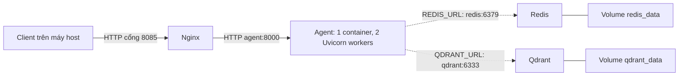
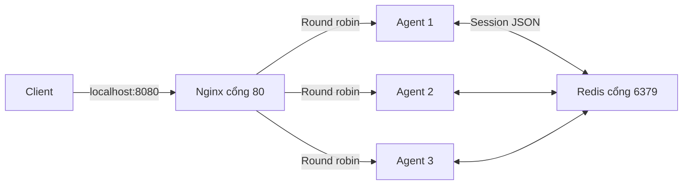

# Day 14 Lab — Mission Answers

## Part 1 — Localhost vs Production (CP1)

Mục tiêu: phân biệt một ứng dụng chạy được trên laptop với ứng dụng có thể cấu hình, theo dõi và vận hành trên server. CP1 sử dụng code mẫu có sẵn, không viết lại ứng dụng.

### Exercise 1.1 — Các anti-pattern trong develop

Đường dẫn trong bảng tính từ gốc repository. Các giá trị secret của bản develop là dữ liệu giả phục vụ bài học; vấn đề nằm ở cách lưu và sử dụng chúng.

| # | Anti-pattern và vị trí | Vì sao là vấn đề? | Cách bản production cải thiện |
|---|---|---|---|
| 1 | `OPENAI_API_KEY` được gán trực tiếp trong `01-localhost-vs-production/develop/app.py`, dòng 17 | Nếu thay bằng key thật rồi push Git, người có quyền đọc repo hoặc lịch sử commit có thể lấy được key. | `production/config.py`, dòng 27 đọc `OPENAI_API_KEY` qua `os.getenv()`. |
| 2 | `DATABASE_URL` chứa tài khoản và mật khẩu trực tiếp trong `develop/app.py`, dòng 18 | Thông tin đăng nhập có thể bị lộ; thay database giữa các môi trường phải sửa code. | Cần chuyển chuỗi kết nối sang biến môi trường. Bản production Part 1 không dùng database nên không có cấu hình tương ứng. |
| 3 | In API key ra log tại `develop/app.py`, dòng 34 | Secret vẫn có thể bị lộ qua log dù repo đã được bảo vệ. | `production/app.py`, dòng 111 và 119 ghi độ dài câu hỏi/câu trả lời, không ghi key. |
| 4 | Port cố định `port=8000` tại `develop/app.py`, dòng 52 | Không thích ứng với port do nền tảng cloud cấp; khó chạy nhiều bản trên cùng máy. | `production/config.py`, dòng 18 đọc `PORT`; `production/app.py`, dòng 197 dùng `settings.port`. |
| 5 | Bind `host="localhost"` tại `develop/app.py`, dòng 51 | Trong container, server chỉ nhận kết nối loopback của chính container, không nhận kết nối qua giao diện mạng của container. | `production/config.py`, dòng 17 mặc định `HOST=0.0.0.0`; `production/app.py`, dòng 196 dùng `settings.host`. |
| 6 | Bật cố định `reload=True` tại `develop/app.py`, dòng 53 | Chế độ theo dõi file và tự khởi động lại phục vụ phát triển, không phù hợp để chạy production. | `production/config.py`, dòng 19 đọc `DEBUG`, mặc định false; `production/app.py`, dòng 198 dùng cấu hình này cho reload. |
| 7 | Không khai báo `/health` và `/ready` trong bản develop | Hệ thống vận hành không có endpoint riêng để kiểm tra process còn sống và ứng dụng sẵn sàng nhận traffic. | `production/app.py`, dòng 135 và 152 khai báo hai route này. Kết quả gọi thật nằm ở Exercise 1.3. |
| 8 | Dùng `print()` tại `develop/app.py`, dòng 33, 34 và 38 | Thiếu mức log và cấu trúc thống nhất, khó lọc và phân tích sự kiện; còn in cả nội dung và key. | `production/app.py` dùng `logging`, các event và thông tin độ dài. Cấu hình JSON của mẫu vẫn có giới hạn, nêu bên dưới. |

Một ví dụ sửa cụ thể: `develop/app.py:52` dùng `port=8000`, còn `production/app.py:197` dùng `port=settings.port`, lấy từ `os.getenv("PORT", "8000")` tại `production/config.py:18`. Như vậy có thể đổi port bằng môi trường mà không sửa mã nguồn.

### Exercise 1.2 — Chạy bản develop

Môi trường kiểm tra: Ubuntu 24.04 WSL2, Python 3.12.3, `os.name=posix`, virtualenv `.venv/core`. Lần chạy bằng chứng: **25/11/2026, 14:39 GMT+7**.

Người học đã chạy `python app.py` trong `01-localhost-vs-production/develop/` và gọi thành công cổng 8000 bằng PowerShell:

```powershell
$response = Invoke-WebRequest -UseBasicParsing -Method POST -Uri "http://localhost:8000/ask?question=Hello"
$response.StatusCode
$response.Content
```

Kết quả người học cung cấp: HTTP **200**, JSON có trường `answer`. Tiếng Việt bị hiển thị sai mã hóa trong PowerShell; request vẫn thành công.

Để lưu bằng chứng có thể chạy lại, đã thực hiện trong Ubuntu từ gốc repo:

```bash
.venv/core/bin/python scripts/run-cp1.py
```

Script bật hai ứng dụng trên **cổng tạm riêng**, gọi HTTP thật, giải mã UTF-8 và lưu [reports/cp1-runtime.json](reports/cp1-runtime.json). Sau kiểm tra, script dừng các process do nó tạo. Server cổng 8000 đang dùng để học không bị dừng.

Bản develop được bật bằng `python -m uvicorn app:app --host 127.0.0.1 --port 45977 --no-access-log` trong thư mục develop, để tránh chiếm cổng 8000. Đây là cùng ASGI app; host/port của lần kiểm tra được CLI ghi đè, còn nhận xét về host/port hardcode phía trên dựa trên entry point `python app.py` trong mã nguồn.

Kết quả thực tế:

```http
POST http://127.0.0.1:45977/ask?question=Hello
HTTP 200

{"answer":"Agent đang hoạt động tốt! (mock response) Hỏi thêm câu hỏi đi nhé."}
```

| Request develop | HTTP thực tế | Ý nghĩa |
|---|---:|---|
| `POST /ask?question=Hello`, không có body | 200 | API hoạt động khi truyền câu hỏi qua query. |
| `POST /ask`, body `{"question":"Hello"}` | 422 | Tham số `question` được yêu cầu ở query; gửi JSON không thay thế được. |
| `GET /health` | 404 | Chưa có health endpoint. |
| `GET /ready` | 404 | Chưa có readiness endpoint. |

### Exercise 1.3 — So sánh với bản production

Script kiểm tra chạy `python app.py` trong thư mục production với `HOST=127.0.0.1`, `PORT=46649`, `DEBUG=false`, `ENVIRONMENT=development`. Đây là cấu hình local; tên thư mục production không có nghĩa là đã deploy lên cloud.

| Tính năng | Develop | Production | Vì sao quan trọng? |
|---|---|---|---|
| Cấu hình | Key, host, port và reload được gán trực tiếp trong code. | Có `Settings`, đọc `HOST`, `PORT`, `DEBUG`, `ENVIRONMENT` và các biến khác từ môi trường. | Cùng source có thể chạy ở nhiều môi trường; cấu hình và secret thật không cần ghi vào code. |
| Liveness | Không có `/health`, gọi thật trả 404. | `/health` trả 200, có status, uptime, version, environment và timestamp. | Cho hệ thống vận hành một endpoint kiểm tra ứng dụng còn phản hồi. |
| Readiness | Không có `/ready`, gọi thật trả 404. | `/ready` trả 200 khi `is_ready=True`, có nhánh trả 503 khi false. | Cho phép phân biệt còn sống với sẵn sàng phục vụ. Trong mẫu này mới kiểm tra cờ nội bộ, chưa kiểm tra Redis/database. |
| Logging | Dùng `print()`, còn in API key. | Dùng `logging`, có cấu hình formatter dạng JSON và event request/response, không ghi key trong các event đó. | Dễ bổ sung mức log, timestamp và trường dữ liệu để tìm lỗi; cần formatter JSON đúng trước khi dùng thực tế. |
| Startup/shutdown | Không định nghĩa lifespan hay cleanup riêng. Khi chạy với Uvicorn, vẫn có cơ chế shutdown mặc định của Uvicorn. | `lifespan()` tại `production/app.py:40` đặt readiness khi khởi động và hạ cờ khi shutdown; có chỗ để thêm cleanup. | Quản lý tài nguyên theo vòng đời ứng dụng; Uvicorn chịu trách nhiệm chờ request đang chạy khi dừng bình thường. |
| Host và port | `localhost:8000` cố định trong entry point. | Mặc định `0.0.0.0`, port đọc từ môi trường. | Nhận kết nối qua mạng container và thích ứng port của nền tảng. |
| Chế độ phát triển | `reload=True` cố định. | `reload=settings.debug`, mặc định false. | Tắt cơ chế theo dõi file khi triển khai để vận hành ổn định hơn. |
| Input | `question` lấy từ query. | Đọc JSON; thiếu hoặc rỗng `question` thì trả 422. | Client phải gửi đúng hợp đồng API; lỗi thiếu dữ liệu được báo rõ ràng. |

Kết quả HTTP thực tế của bản production:

| Request production | HTTP thực tế | Nội dung chính |
|---|---:|---|
| `POST /ask`, body `{"question":"Hello"}` | 200 | Có `question`, `answer` và `model`. |
| `GET /health` | 200 | `status="ok"`, `environment="development"`, `version="1.0.0"`. |
| `GET /ready` | 200 | `{"ready":true}`. |
| `POST /ask`, body `{}` | 422 | `{"detail":"question field is required"}`. |

Response thực tế của `POST /ask`:

```json
{
  "question": "Hello",
  "answer": "Tôi là AI agent được deploy lên cloud. Câu hỏi của bạn đã được nhận.",
  "model": "gpt-4o-mini"
}
```

Nội dung câu trả lời và tên model là dữ liệu của mock/config; lần kiểm tra này chạy local, không gọi API LLM thật và không chứng minh đã deploy cloud.

### Giải thích các điểm chính

- **Hardcode secret nguy hiểm:** secret có thể bị đọc từ repo và lịch sử commit; nếu đã lộ phải thu hồi và thay key. Chuyển sang biến môi trường giúp tách secret khỏi code, đồng thời vẫn phải tránh ghi secret ra log.
- **Health khác readiness:** health giúp biết ứng dụng còn phản hồi, readiness giúp quyết định có gửi traffic tới nó hay không. Một process còn sống vẫn có thể chưa sẵn sàng vì đang nạp model hoặc mất kết nối dịch vụ phụ thuộc.
- **Graceful shutdown:** khi nhận yêu cầu dừng, server ngừng nhận kết nối mới, chờ công việc đang xử lý hoàn thành trong thời gian cho phép rồi dọn tài nguyên. Mục đích là giảm việc cắt ngang request khi cập nhật hoặc dừng dịch vụ. Bản mẫu có lifespan để minh họa; 8 kiểm tra HTTP CP1 không phải phép thử SIGTERM trong lúc có request.
- **Giới hạn của logging mẫu:** formatter tại `production/app.py:30` ghép chuỗi có thể tạo JSON không hợp lệ nếu message chứa dấu ngoặc kép. Ngoài ra, `config.py` có thể gọi `logging.warning()` trước khi `app.py` cấu hình logging, khiến `basicConfig()` phía sau không áp dụng formatter mới. Vì vậy có ý tưởng structured logging nhưng chưa nên kết luận mọi dòng log đều là JSON hợp lệ.

**Kết quả CP1:** có hơn 5 anti-pattern kèm vị trí code, có bằng chứng chạy develop, có bảng so sánh và giải thích. **8/8 trường hợp HTTP đạt kết quả mong đợi**; HTTP 422 và 404 ở các trường hợp trên là kết quả kiểm tra có chủ đích. Source của ứng dụng mẫu được giữ nguyên.

## Part 2 — Docker Containerization (CP2)

Mục tiêu: đóng gói agent để chạy trong container, so sánh image develop với image production, rồi vận hành nhiều dịch vụ bằng Docker Compose. Các lệnh dưới đây chạy trong **Ubuntu WSL2**; Docker Desktop cần đang mở.

**CP2 đã hoàn thành.** Lượt kiểm tra thành công bắt đầu lúc **15:10 GMT+7 ngày 25/11/2026**, dùng Docker Engine 29.9.3 và Compose v5.7.0. Đã build/chạy cả hai image và kiểm tra stack agent + Redis + Qdrant + Nginx. Kích thước giảm **85,62%**, **8/8 request HTTP trả 200** như mong đợi.

Bằng chứng: [reports/cp2-runtime.json](reports/cp2-runtime.json), [log build develop](reports/cp2-build-develop.log), [log build production](reports/cp2-build-production.log) và [log Compose](reports/cp2-compose.log). Lệnh tự động đã chạy từ gốc repo:

```bash
.venv/core/bin/python scripts/run-cp2.py
```

Script dùng cổng host tạm do Docker cấp cho hai container chạy riêng; các lệnh 8003/8004 phía dưới là cách chạy lại thủ công. Stack Compose thực tế dùng cổng **8085** vì cổng 80 đang có tiến trình System của Windows lắng nghe. File `compose.cp2-local.yml` chỉ ghi đè port mapping, giữ nguyên ứng dụng và Dockerfile mẫu.

Vấn đề môi trường ban đầu đã xử lý: ổ C gần đầy gây lỗi ghi image; theo sự đồng ý của người học, đã tạm dừng WSL và chuyển dữ liệu Docker sang `D:\DockerData\DockerDesktopWSL`, xác minh bản sao bằng SHA256, chạy Engine/hello-world rồi mới xóa bản nguồn cũ trên C. [Báo cáo môi trường](reports/cp2-environment.json) ghi kết quả. Không thay đổi script chấm Part 6 hay golden dataset.

### Exercise 2.1 — Đọc Dockerfile và trả lời 4 câu hỏi

| Câu hỏi | Trả lời theo Dockerfile thực tế | Mục đích |
|---|---|---|
| Base image là gì? | `02-docker/develop/Dockerfile:8` dùng `FROM python:3.11`. Đây là image Python đầy đủ, không phải bản slim. | Cung cấp hệ điều hành nền và Python 3.11 trong container, độc lập với Python 3.12 của virtualenv WSL. |
| Working directory là gì? | Dòng 11 dùng `WORKDIR /app`. | Các lệnh tiếp theo như `COPY ... .`, cài requirements và `python app.py` làm việc tại `/app` trong container. |
| Vì sao copy requirements trước source? | Dòng 14 copy `requirements.txt`, dòng 17 cài thư viện, sau đó dòng 20 mới copy app. | Nếu chỉ đổi source, Docker có thể dùng lại layer cài thư viện đã cache; tránh tải và cài lại các package không đổi. |
| CMD khác ENTRYPOINT thế nào? | `CMD` đặt lệnh hoặc tham số mặc định; `ENTRYPOINT` đặt chương trình chính. Với exec form, chúng có thể kết hợp thành `ENTRYPOINT + CMD`. Lệnh sau tên image thường thay `CMD`; muốn thay `ENTRYPOINT` dùng `--entrypoint`. File này dùng `CMD ["python", "app.py"]`, không tự khai báo ENTRYPOINT. | Chọn cách khởi chạy app và hiểu cách ghi đè để debug. Ví dụ `docker run --rm my-agent:develop python --version` thay lệnh chạy app bằng kiểm tra Python. |

Tham khảo: [Dockerfile reference](https://docs.docker.com/reference/dockerfile/) và [tối ưu cache](https://docs.docker.com/build/cache/optimize/).

### Exercise 2.2 — Build và chạy container develop

**Bước 1: build từ gốc repo.**

```bash
docker build -f 02-docker/develop/Dockerfile -t my-agent:develop .
```

- `-f` chọn Dockerfile; `-t` đặt tên/tag cho image.
- Dấu `.` là build context: Docker lấy các file được `COPY` từ gốc repo. Không chạy build từ thư mục develop vì Dockerfile dùng đường dẫn `02-docker/develop/...`.
- `RUN pip install` cài thư viện bên trong image, không dùng thư viện của `.venv/core`.

**Bước 2: tạo container từ image.**

```bash
docker run --rm -d --name k5-cp2-develop -p 127.0.0.1:8003:8000 my-agent:develop
```

- Image là bản đóng gói; container là một phiên chạy của image đó.
- `-d` chạy nền; `--name` đặt tên để xem log/dừng; `--rm` xóa container khi nó dừng, vẫn giữ image.
- `8003:8000` chuyển request cổng 8003 trên máy vào cổng 8000 trong container. Dùng 8003 để tránh cổng 8000 của CP1. `EXPOSE 8000` trong Dockerfile chỉ mô tả cổng; phải có `-p` nếu muốn truy cập từ máy host.

**Bước 3: gọi API để chứng minh app thực sự chạy trong container.**

```bash
curl -i http://localhost:8003/health
curl -i -X POST 'http://localhost:8003/ask?question=What%20is%20Docker?'
docker logs k5-cp2-develop
docker stop k5-cp2-develop
```

Bản develop nhận `question` qua query. `docker logs` giúp xem lỗi ứng dụng khi container không phản hồi; `docker stop` dừng đúng container sau khi kiểm tra.

### Exercise 2.3 — Multi-stage build và đo kích thước

**Bước 4: build bản production từ gốc repo.**

```bash
docker build -f 02-docker/production/Dockerfile -t my-agent:advanced .
docker images my-agent
docker image inspect my-agent:develop --format '{{.Size}}'
docker image inspect my-agent:advanced --format '{{.Size}}'
```

| Stage | Làm gì? | Có trong image cuối không? |
|---|---|---|
| `builder` (`python:3.11-slim`) | Cài `gcc`, `libpq-dev` và Python dependencies bằng `pip install --user`. | Layer cài build tools của builder không được mang sang runtime. |
| `runtime` (`python:3.11-slim`) | Copy thư viện từ `/root/.local` của builder sang `/home/appuser/.local`, copy code, chuyển sang `appuser`, thêm healthcheck và chạy Uvicorn. | Đây là stage được dùng để chạy/deploy. |

Image nhỏ hơn nhờ **base slim và chọn lọc nội dung mang sang runtime**. Multi-stage không tự giảm kích thước nếu vẫn copy mọi thứ hoặc giữ base quá lớn. Build cache có thể còn giữ builder trên máy; dung lượng image runtime không đồng nghĩa toàn bộ dung lượng Docker đang chiếm trên ổ đĩa. [Docker multi-stage builds](https://docs.docker.com/build/building/multi-stage/).

**Số đo thực tế của hai image:**

| Image | Byte từ `docker image inspect` | MB (1 MB = 1.000.000 byte) | MiB (1 MiB = 1.048.576 byte) |
|---|---:|---:|---:|
| `my-agent:develop` | 1.667.775.889 | 1.667,78 | 1.590,52 |
| `my-agent:advanced` | 239.815.088 | 239,82 | 228,71 |

```text
% giảm = (1.667.775.889 - 239.815.088) / 1.667.775.889 × 100
       = 85,62%
```

Output `docker images my-agent` của lần chạy:

```text
IMAGE               ID             DISK USAGE   CONTENT SIZE
my-agent:advanced   dd34d1fc6174        240MB         57.4MB
my-agent:develop    dfa01a5392bd       1.67GB          426MB
```

Docker phiên bản này in riêng `DISK USAGE` và `CONTENT SIZE`. Bảng và phép tính dùng cùng trường `.Size` của `docker image inspect` để so sánh nhất quán; không trộn các cột với nhau. Image production dưới 500 MB. ID và số byte trong báo cáo JSON giữ bằng chứng của lần chạy này; build lại có thể tạo ID khác.

Kết quả chạy container riêng:

| Image | Request | HTTP thực tế |
|---|---|---:|
| Develop | `GET /health` | 200 |
| Develop | `POST /ask?question=What%20is%20Docker?` | 200 |
| Production | `GET /health` | 200 |
| Production | `POST /ask`, JSON `{"question":"What is Docker?"}` | 200 |
| Production | `GET /ready` | 200 |

**Bước 5: chạy thử bản production** để bảo đảm image nhỏ vẫn có đủ thư viện và app hoạt động:

```bash
docker run --rm -d --name k5-cp2-advanced -p 127.0.0.1:8004:8000 my-agent:advanced
curl -i http://localhost:8004/health
curl -i -X POST http://localhost:8004/ask \
  -H 'Content-Type: application/json' -d '{"question":"What is Docker?"}'
docker stop k5-cp2-advanced
```

Bản production nhận body JSON. Dùng user non-root giảm quyền của process trong container; đây là một cải thiện khác ngoài giảm kích thước.

### Exercise 2.4 — Chạy stack Docker Compose

**Bước 6: bật nhiều dịch vụ cùng một lệnh.** Từ gốc repo:

```bash
cd 02-docker/production
# File .env.local đã được tạo khi setup, không chứa API key LLM thật.
docker compose -p k5-day14-docker -f docker-compose.yml -f compose.cp2-local.yml up -d --build --wait
docker compose -p k5-day14-docker -f docker-compose.yml -f compose.cp2-local.yml ps
```

`--build` cập nhật image từ code, `-d` chạy nền, `--wait` đợi các service running/healthy. `-p` đặt tên project riêng để không nhầm stack Part 5/7 có cùng tên thư mục production. Các lệnh `ps`, `logs`, `down` phải dùng cùng tên project.

`-f docker-compose.yml -f compose.cp2-local.yml` ghép cấu hình stack với override local; `ports: !override` thay danh sách publish bằng `127.0.0.1:8085:80`, không mở cổng 443 của mẫu. Đây là cách tránh cổng 80 của Windows mà vẫn đi qua Nginx.



| Service | Vai trò | Cách kết nối |
|---|---|---|
| Nginx | Cổng vào cho client, reverse proxy và giới hạn request theo IP. | Cấu hình gốc publish 80; override local dùng `127.0.0.1:8085:80`, forward HTTP tới `agent:8000`. |
| Agent | FastAPI xử lý câu hỏi và gọi mock LLM. | Trong network Compose, không publish cổng riêng. Mặc định có **1 container**, chạy **2 worker**, không phải 2 replica. |
| Redis | Dịch vụ lưu cache/session/rate-limit cho ứng dụng có tích hợp Redis. | DNS `redis`, cổng 6379; volume giữ dữ liệu qua việc xóa container. |
| Qdrant | Vector database để ứng dụng có thể tìm tài liệu cho RAG. | DNS `qdrant`, cổng 6333; volume lưu dữ liệu. |

Các đường nét đứt biểu diễn URL/dependency được cấu hình. **`production/main.py` của Part 2 chỉ gọi mock LLM, chưa thực hiện truy vấn Redis hay Qdrant trong `/ask`.** Bật đủ 4 service không đồng nghĩa đã có RAG hoặc session persistence.

Compose chờ Redis và Qdrant healthy trước khi khởi động agent, nhờ `depends_on` với `condition: service_healthy`. Nginx chỉ khai báo phụ thuộc agent khởi động, không chờ healthcheck của agent theo điều kiện này. [Docker Compose startup order](https://docs.docker.com/compose/how-tos/startup-order/).

**Bước 7: gọi qua Nginx**, không gọi trực tiếp agent:

```bash
curl -i http://localhost:8085/health
curl -i http://localhost:8085/ready
curl -i -X POST http://localhost:8085/ask \
  -H 'Content-Type: application/json' -d '{"question":"Explain microservices"}'
docker compose -p k5-day14-docker -f docker-compose.yml -f compose.cp2-local.yml exec -T redis redis-cli ping
docker compose -p k5-day14-docker -f docker-compose.yml -f compose.cp2-local.yml logs agent nginx
```

Mục đích: xác nhận toàn bộ đường đi **client → Nginx → agent** hoạt động. `PONG` kiểm tra Redis còn phản hồi; log giúp phân biệt lỗi Nginx với lỗi agent.

**Kết quả thật khi stack đang chạy:**

| Kiểm tra | Kết quả |
|---|---|
| Trạng thái agent, Redis, Qdrant | Cả ba `running`, health `healthy`. |
| Trạng thái Nginx | `running`, publish `127.0.0.1:8085 → 80/tcp`. |
| `GET http://127.0.0.1:8085/health` | HTTP 200. |
| `GET http://127.0.0.1:8085/ready` | HTTP 200. |
| `POST http://127.0.0.1:8085/ask`, JSON có `question` | HTTP 200, có `answer`. |
| `redis-cli ping` trong service Redis | `PONG`. |
| Agent gọi `http://qdrant:6333/healthz` | HTTP 200, `healthz check passed`; xác nhận DNS/network nội bộ tới Qdrant. |
| `id` trong agent | `uid=999(appuser) gid=999(appuser) groups=999(appuser)`; không chạy root. |
| `nginx -t` trong Nginx | Exit code 0; cấu hình hợp lệ. |

**Bước 8: dọn stack sau khi lấy bằng chứng.**

```bash
docker compose -p k5-day14-docker -f docker-compose.yml -f compose.cp2-local.yml down
```

Lệnh này dừng/xóa container và network của project, giải phóng cổng; vẫn giữ image và named volumes. Chỉ thêm `-v` khi chủ động muốn xóa cả dữ liệu volume.

Đã thực hiện `down` sau khi lưu bằng chứng. Các container CP2 đã dừng/xóa; Docker Desktop vẫn hoạt động, image và named volumes vẫn được giữ.

Hai lưu ý khi đọc comment của mẫu: `HEALTHCHECK` đánh dấu healthy/unhealthy, không tự bảo đảm restart container; map cổng 443 trong Compose chưa tạo HTTPS vì Nginx hiện chỉ có cấu hình listen 80.

## Part 4 — API Security (CP3)

**CP3 đã hoàn thành: 34/34 kiểm tra đạt kết quả mong đợi.** Lượt chạy bắt đầu **15:15 GMT+7 ngày 25/11/2026**, dùng Ubuntu WSL2, Python 3.12.3 và hai môi trường core/gateway đã cài. Đây là **Part 4** theo lịch checkpoint K5, không phải Part 3 deploy cloud.

Đã chạy từ gốc repo trong Ubuntu:

```bash
.venv/gateway/bin/python scripts/run-cp3.py
```

Bằng chứng: [reports/cp3-runtime.json](reports/cp3-runtime.json) và [toàn bộ output curl -i](reports/cp3-curl.txt). Script chạy server trên cổng tạm, gọi HTTP bằng `curl --include` (tương đương `curl -i`), che token/key trước khi lưu, rồi dừng các server do nó tạo. Source ứng dụng mẫu được giữ nguyên.

### Exercise 4.1 — API key authentication

**Bước 1: yêu cầu client chứng minh có quyền gọi API.** Bản develop đọc key từ `AGENT_API_KEY` tại `04-api-gateway/develop/app.py:35`; `APIKeyHeader(name="X-API-Key", auto_error=False)` đọc header, còn `verify_api_key()` kiểm tra key. Endpoint `/ask` gắn dependency này tại dòng 70.

| Trường hợp | HTTP thực tế | Mục đích |
|---|---:|---|
| Không gửi `X-API-Key` | 401 | Chặn client chưa cung cấp thông tin xác thực. |
| Gửi key sai | 403 | Bản mẫu từ chối key không khớp. |
| Gửi key đúng | 200 | Cho phép client hợp lệ gọi mock agent. |

Thiếu key không bị FastAPI trả 422 vì `auto_error=False` cho phép code tự trả 401. Cần phân biệt: **bản mẫu CP3 trả 403 khi key sai**; hợp đồng Part 6 yêu cầu cả thiếu và sai key trả 401.

Cách chạy lại thủ công với key demo của bài, từ gốc repo:

```bash
source .venv/core/bin/activate
cd 04-api-gateway/develop
AGENT_API_KEY=secret-key-123 python app.py
```

Trong terminal Ubuntu thứ hai:

```bash
curl -i -X POST http://localhost:8000/ask \
  -H 'Content-Type: application/json' -d '{"question":"What is Docker?"}'
curl -i -X POST http://localhost:8000/ask \
  -H 'X-API-Key: secret-key-123' -H 'Content-Type: application/json' \
  -d '{"question":"What is Docker?"}'
```

Lần kiểm tra tự động dùng key ngẫu nhiên riêng và không lưu giá trị thật. Khi rotate key, đổi `AGENT_API_KEY` và khởi động lại app vì mẫu đọc biến một lần khi import; cập nhật client để dùng key mới và bỏ key cũ. Bản develop còn in key lúc chạy `python app.py`, nên chỉ dùng key demo trong bài; trước khi dùng thật phải bỏ việc log key.

### Exercise 4.2 — JWT authentication

**Bước 2: đăng nhập để nhận token có thời hạn.** Tắt server develop bằng Ctrl+C trước khi dùng cùng cổng 8000. Từ gốc repo:

```bash
source .venv/gateway/bin/activate
cd 04-api-gateway/production
export JWT_SECRET=$(python -c "import secrets; print(secrets.token_urlsafe(48))")
python app.py
```

Trong terminal Ubuntu thứ hai, lấy token vào biến mà không in ra màn hình:

```bash
TOKEN=$(curl -sS -X POST http://localhost:8000/auth/token \
  -H 'Content-Type: application/json' \
  -d '{"username":"student","password":"demo123"}' \
  | python3 -c 'import json,sys; print(json.load(sys.stdin)["access_token"])')
```

Endpoint đúng là **`POST /auth/token`**, tài khoản demo **`student` / `demo123`**. Flow trong `production/auth.py`:

1. `authenticate_user()` so sánh thông tin đăng nhập với danh sách demo.
2. `create_token()` ký JWT bằng HS256, dùng `JWT_SECRET`; payload chứa `sub`, `role`, `iat`, `exp`.
3. Client gửi `Authorization: Bearer <token>` khi gọi `/ask`.
4. `verify_token()` xác minh chữ ký và thời hạn trước khi trả user/role cho endpoint.

JWT có chữ ký để kiểm tra tính toàn vẹn; payload không được mã hóa chỉ vì được đóng thành JWT. Lần chạy đã xác minh chữ ký bằng signing key của process và kiểm tra `exp - iat = 3600` giây, tức **60 phút**. Signing key và token của lần thử được giữ trong bộ nhớ, không lưu vào báo cáo.

| Trường hợp | HTTP thực tế | Ý nghĩa |
|---|---:|---|
| Đăng nhập sai password | 401 | Không cấp token. |
| Đăng nhập student đúng | 200 | Cấp bearer token, hết hạn sau 60 phút. |
| Gọi `/ask` thiếu JWT | 401 | Yêu cầu xác thực, có header `WWW-Authenticate: Bearer`. |
| Gọi `/ask` với JWT không hợp lệ | 403 | Đúng hành vi mẫu tại `auth.py:66`. |
| JWT đã hết hạn, được ký đúng key trong phép thử | 401 | Kiểm tra thời hạn token thực sự có tác dụng. |
| Student gọi `/admin/stats` | 403 | Đã đăng nhập nhưng không có role admin. |
| Gửi `question` rỗng với token hợp lệ | 422 | Xác thực không thay thế kiểm tra dữ liệu đầu vào. |

### Exercise 4.3 — Rate limiting

**Bước 3: dùng token hợp lệ gửi 20 request liên tiếp để kiểm tra giới hạn tốc độ.** Đây là lệnh chạy lại trong Ubuntu, giữ `TOKEN` từ bước đăng nhập:

```bash
for i in $(seq 1 20); do
  printf '\nRequest %s\n' "$i"
  curl -sS -i -X POST http://localhost:8000/ask \
    -H "Authorization: Bearer $TOKEN" -H 'Content-Type: application/json' \
    -d "{\"question\":\"Rate limit test $i\"}"
done
```

Lần chạy bằng chứng dùng process mới, chưa có `/ask` thành công của student trước vòng lặp. **20 request mất 1,481 giây**, nhỏ hơn cửa sổ 60 giây:

| Request | HTTP thực tế | Diễn giải |
|---|---:|---|
| 1–10 | 200 | Còn quota cho student. |
| 11–20 | 429 | Đã đủ 10 request trong cửa sổ 60 giây. |

Nếu đã gọi `/ask` thành công trước vòng lặp, số request 200 còn lại sẽ ít hơn 10. Đăng nhập lại không tự reset quota vì limiter dùng **username**, không dùng chuỗi token làm khóa.

Thuật toán thực tế tại `production/rate_limiter.py:29` dùng **cửa sổ trượt với deque timestamp**: xóa các request cũ hơn 60 giây, đếm timestamp còn lại, đủ limit thì trả 429; còn quota thì thêm timestamp mới. Comment gọi là Sliding Window Counter, nhưng dữ liệu ở đây là từng timestamp, không phải các bucket đếm tổng hợp.

- User/student: **10 request/60 giây**, cấu hình tại dòng 86.
- Admin/teacher: **100 request/60 giây**, cấu hình tại dòng 87.
- Admin trong mẫu có quota cao hơn, **không bypass hoàn toàn**. Nếu thiết kế yêu cầu admin không bị giới hạn, phải quyết định bỏ qua limiter sau khi đã xác minh role; mẫu hiện tại không làm điều đó.
- `Retry-After` cho client biết cần chờ bao lâu trước khi thử lại; request 11 trong lần đo trả **59 giây**.
- State nằm trong RAM (`defaultdict(deque)`), riêng từng process; restart mất state và nhiều worker không chia sẻ quota. Đây là bản demo CP3; Part 6 cần Redis.

**Output curl -i thực tế của ba trường hợp bắt buộc** (các token/key đã được che trong báo cáo đầy đủ):

Thiếu JWT:

```http
HTTP/1.1 401 Unauthorized
date: Wed, 25 Nov 2026 08:15:54 GMT
server: uvicorn
www-authenticate: Bearer
content-length: 76
content-type: application/json
vary: Origin
x-content-type-options: nosniff
x-frame-options: DENY
x-xss-protection: 1; mode=block
referrer-policy: strict-origin-when-cross-origin

{"detail":"Authentication required. Include: Authorization: Bearer <token>"}
```

Request đầu tiên có JWT hợp lệ:

```http
HTTP/1.1 200 OK
date: Wed, 25 Nov 2026 08:15:54 GMT
server: uvicorn
content-length: 190
content-type: application/json
vary: Origin
x-content-type-options: nosniff
x-frame-options: DENY
x-xss-protection: 1; mode=block
referrer-policy: strict-origin-when-cross-origin

{"question":"Rate limit test 1","answer":"Agent đang hoạt động tốt! (mock response) Hỏi thêm câu hỏi đi nhé.","usage":{"requests_remaining":9,"budget_remaining_usd":1.7e-05}}
```

Request thứ 11:

```http
HTTP/1.1 429 Too Many Requests
date: Wed, 25 Nov 2026 08:15:55 GMT
server: uvicorn
x-ratelimit-limit: 10
x-ratelimit-remaining: 0
x-ratelimit-reset: 1795594615
retry-after: 59
content-length: 98
content-type: application/json
vary: Origin
x-content-type-options: nosniff
x-frame-options: DENY
x-xss-protection: 1; mode=block
referrer-policy: strict-origin-when-cross-origin

{"detail":{"error":"Rate limit exceeded","limit":10,"window_seconds":60,"retry_after_seconds":59}}
```

Header `date` của HTTP dùng GMT/UTC; tương ứng 15:15 GMT+7 trong lần chạy. Body và kích thước response là của mẫu mock tại thời điểm thử, không phải số liệu tự đặt.

### Exercise 4.4 — Cost guard

**Bước 4: kiểm tra chi phí để chặn sử dụng vượt ngân sách.** Luồng xử lý trong `production/app.py` là JWT hợp lệ → chọn limiter theo role → kiểm tra rate limit → kiểm tra budget → gọi mock LLM → ghi nhận token/cost.

`production/cost_guard.py` mặc định giới hạn **1 USD/ngày/user**, tổng **10 USD** cho process theo cấu hình demo. Giá dưới đây là hằng số mô phỏng trong source, không phải xác nhận bảng giá LLM hiện hành:

```text
cost_usd = input_tokens / 1000 × 0,00015
         + output_tokens / 1000 × 0,0006
```

`check_budget()` được gọi trước khi gọi LLM. Khi tổng chi phí user đã chạm budget thì trả **402**. Sau khi LLM trả lời, `record_usage()` cộng token và cost vào bộ nhớ. Mẫu ước lượng số token bằng số từ × 2; không gọi nhà cung cấp LLM thật và không phát sinh hóa đơn LLM.

**Kiểm tra cost guard thực tế:** script tạo một process production riêng rồi đặt `cost_guard.daily_budget_usd=0.000001` chỉ trong process đó để nhanh chạm giới hạn. Không sửa file, không đổi ngân sách mặc định của app mẫu.

| Request trong phép thử budget riêng | Kết quả thực tế |
|---|---|
| Đăng nhập student | 200. |
| Gọi `/ask` lần đầu | 200; chi phí đã ghi vượt budget thử. |
| Gọi `/ask` lần thứ hai | **402 Payment Required**, chưa gọi LLM tiếp. |

Body lỗi thật:

```json
{"detail":{"error":"Daily budget exceeded","used_usd":1.9e-05,"budget_usd":1e-06,"resets_at":"midnight UTC"}}
```

Trong process mặc định, `/me/usage` sau vòng lặp ghi **10 request**, 80 input tokens, 272 output tokens, cost **0,000175 USD mô phỏng**, budget còn **0,999825 USD**. Mười request bị 429 không được gọi LLM và không tăng số request trong usage.

**Vì sao cần cả rate limit và cost guard?** Rate limit giới hạn tốc độ để tránh quá tải; một client vẫn có thể gọi đều đặn cả ngày dưới rate limit nhưng tiêu hết ngân sách. Cost guard bảo vệ tổng chi phí; chỉ có budget cũng không tránh được một đợt gọi dồn gây quá tải.

**Cách triển khai yêu cầu 10 USD/tháng/user bằng Redis:**

1. Dùng user đã xác thực làm khóa, ví dụ `budget:<user_id>:<YYYY-MM>` theo tháng UTC.
2. Đọc tổng chi phí đã dùng, kiểm tra cùng chi phí dự kiến trước khi gọi LLM; vượt hạn thì trả 402.
3. Dùng Lua/transaction để kiểm tra và giữ chỗ budget một cách atomic khi có nhiều request đồng thời, tránh hai worker cùng thấy còn tiền rồi cùng cho qua.
4. Sau response, dùng usage token thực tế để đối soát số tiền đã giữ chỗ; xử lý hoàn lại/đối soát khi lời gọi thất bại.
5. Tháng mới dùng khóa mới; đặt TTL để dọn các khóa cũ. Các instance dùng chung Redis nên không mất budget khi restart hay scale.

Đây là thiết kế giải thích cho Exercise 4.4; **bản mẫu CP3 hiện dùng RAM theo ngày, chưa phải Redis theo tháng**. Theo CHECKPOINTS K5, CP3 chạy ví dụ và giải thích cách làm, không viết lại mẫu. Triển khai Redis thực tế thuộc phần công việc của Part 6.

Một số giới hạn thấy được từ source:

- Guard kiểm tra chi phí đã dùng rồi mới ghi cost sau request; lần gọi đầu có thể vượt budget nhỏ trước khi request tiếp bị chặn, đúng như phép thử trên. Muốn bảo vệ chặt hơn cần giữ chỗ chi phí dự kiến.
- Nhánh hết budget toàn cục trả **503**, khác 402 cho budget từng user. Biến `_global_today` được tạo nhưng chưa có logic reset `_global_cost` khi sang ngày mới; không nên kết luận bộ đếm toàn cục tự reset hằng ngày.
- Trường `budget_remaining_usd` trong response `/ask` đang gán `usage.total_cost_usd` tại `production/app.py:160`, thực chất là số đã dùng. `/me/usage` mới tính phần còn lại bằng budget trừ cost. Không dùng nhầm trường này để kết luận ngân sách còn lại.
- Per-user day dùng `time.strftime()` theo timezone của process; chuỗi lỗi `resets_at="midnight UTC"` chưa tự bảo đảm timezone reset là UTC.

**Tổng kết CP3:** đã có bằng chứng 401/200/429, đăng nhập JWT đúng endpoint, kiểm tra token hết hạn/role/input, thử cost guard 402 và giải thích sự khác nhau giữa giới hạn tốc độ với ngân sách. Các file bằng chứng không lưu token/key thật; server thử đã được dừng sau khi lưu kết quả.

## Part 5 — Scaling & Reliability (CP4)

**CP4 đã hoàn thành.** Lượt kiểm tra thành công bắt đầu **15:32 GMT+7 ngày 25/11/2026**. Đã kiểm tra shutdown khi đang có request, chạy **3 agent instance**, xác nhận history qua nhiều instance và sau restart, cùng liveness/readiness khi Redis mất phản hồi.

Mục tiêu: phân biệt liveness/readiness, dừng server không cắt ngang request và chạy nhiều instance dùng chung session qua Redis. CP4 thực hành trên các ví dụ đã có theo lịch K5; chỉ bổ sung timeout Redis và tắt retry kéo dài trong client production để probe phản hồi sớm khi Redis không trả lời.

Lệnh thu thập bằng chứng từ gốc repo trong Ubuntu WSL2:

```bash
.venv/core/bin/python scripts/run-cp4.py
```

Script kiểm tra bản develop, bật stack `k5-day14-scaling`, chạy nguyên bản `test_stateless.py`, kiểm tra thêm session sau khi restart một agent và readiness khi Redis bị pause. Bằng chứng: [reports/cp4-runtime.json](reports/cp4-runtime.json), [output script stateless](reports/cp4-stateless.txt), [log shutdown](reports/cp4-graceful.log) và [log Compose](reports/cp4-compose.log).

### Exercise 5.1 — Health check và readiness

**Bước 1: kiểm tra hai loại trạng thái của ứng dụng.** Từ gốc repo trong Ubuntu:

```bash
source .venv/core/bin/activate
cd 05-scaling-reliability/develop
PORT=8006 python app.py
```

Terminal Ubuntu thứ hai:

```bash
curl -i http://localhost:8006/health
curl -i http://localhost:8006/ready
```

| Probe | Câu hỏi cần trả lời | Hành vi của mẫu |
|---|---|---|
| `/health` — liveness | Process còn sống và phản hồi không? | Bản develop trả HTTP 200, kèm uptime, environment và thông tin memory. Body có thể là `degraded` nếu memory cao, nhưng HTTP vẫn 200. |
| `/ready` — readiness | Có nên gửi request nghiệp vụ tới instance này không? | Bản develop trả 200 khi `_is_ready=True`, trả 503 khi false. Bản production kiểm tra Redis khi đã kết nối thành công từ lúc startup. |

Liveness giúp nền tảng quyết định khi nào cần restart process; readiness giúp loại một instance chưa sẵn sàng khỏi đường nhận traffic. Mất Redis không nhất thiết có nghĩa process đã chết: ứng dụng vẫn có thể trả lời `/health` nhưng cần trả 503 ở `/ready`.

Trong source develop, cờ `_is_ready` nằm ở dòng 37 và được quản lý bởi `lifespan()` tại dòng 42. `/health` nằm ở dòng 105, `/ready` ở dòng 148. Lần kiểm tra tự động dùng cổng tạm riêng và xác nhận cả hai trả **200** khi startup hoàn tất.

### Exercise 5.2 — Graceful shutdown

**Bước 2: gửi SIGTERM khi request còn đang xử lý.** Mục đích là kiểm tra server hoàn thành request rồi dọn tài nguyên, thay vì ngắt kết nối ngay khi được yêu cầu dừng.

Phép thử dùng entry point gốc `app.py`, được chạy qua `runpy` trong process riêng. Chỉ trong process thử, mock LLM có delay **1 giây** và ghi marker khi bắt đầu xử lý; source trên đĩa không bị sửa. Script đợi marker rồi gửi `SIGTERM` tới đúng process nó tạo. Điều này bảo đảm tín hiệu được gửi khi có request in-flight, không dựa vào một khoảng sleep đoán trước.

| Quan sát thực tế | Kết quả |
|---|---|
| `/health` và `/ready` trước khi gửi request | Cả hai HTTP 200. |
| Marker cho biết request đã vào mock LLM trước SIGTERM | Có. |
| `POST /ask?question=Hello` đang xử lý | Vẫn trả HTTP **200**, có `answer`. |
| Thời gian request | **1,028 giây**. |
| Thời gian từ SIGTERM tới process thoát | **1,217 giây**. |
| Exit code | **0**. |
| Log cleanup | Có `Graceful shutdown initiated` và `Shutdown complete`. |

Trích log thật trong [reports/cp4-graceful.log](reports/cp4-graceful.log):

```text
INFO:     Shutting down
INFO:     127.0.0.1:46456 - "POST /ask?question=Hello HTTP/1.1" 200 OK
INFO:     Waiting for application shutdown.
2026-11-25 15:32:59,822 INFO 🔄 Graceful shutdown initiated...
2026-11-25 15:32:59,822 INFO ✅ Shutdown complete
INFO:     Application shutdown complete.
INFO:     Finished server process [2302]
```

Uvicorn nhận tín hiệu, ngừng nhận kết nối mới và chờ công việc đang chạy trước khi gọi phần cleanup của lifespan. Trong mẫu, `_is_ready=False` được đặt ở phần cuối lifespan; không nên kết luận cờ đó đổi ngay lúc tín hiệu vừa tới. `timeout_graceful_shutdown=30` tại `develop/app.py:198` giới hạn thời gian chờ của server. Đây là bằng chứng của một request có kiểm soát, không phải cam kết mọi loại request đều có thể hoàn thành trong mọi tình huống. SIGKILL không cho phép thực hiện cleanup như SIGTERM.

### Exercise 5.3 — Stateless design và Redis session

**Bước 3: đưa state dùng chung ra khỏi RAM của agent.** Nếu mỗi instance giữ dictionary hội thoại riêng, request tiếp theo qua load balancer tới instance khác sẽ không thấy history trước đó.

Trong `05-scaling-reliability/production/app.py`:

- `save_session()` tại dòng 68 chuyển session thành JSON rồi gọi Redis `SETEX` ở dòng 72.
- Khóa Redis có dạng `session:<session_id>`, TTL **3.600 giây**; mỗi lần ghi lại session sẽ cập nhật TTL.
- `load_session()` tại dòng 77 đọc từ Redis, nên các instance có thể truy cập cùng dữ liệu.
- `append_to_history()` tại dòng 85 lưu message user/assistant, giữ tối đa **20 message** tương đương 10 lượt hỏi/đáp.
- `POST /chat` tạo `session_id` khi client chưa gửi, rồi trả `session_id`, `served_by` và loại `storage` để quan sát instance phục vụ.

Stateless ở đây nghĩa là **agent không giữ session duy nhất trong RAM của chính nó**; hệ thống vẫn có state, nhưng Redis chịu trách nhiệm lưu state đó. Nhờ vậy có thể thay/restart agent mà không xóa session đang có trong Redis.

### Exercise 5.4 — Load balancing với 3 instance

**Bước 4: bật 3 agent, Redis và Nginx.** Từ thư mục production:

```bash
cd 05-scaling-reliability/production
docker compose -p k5-day14-scaling up -d --build --scale agent=3
docker compose -p k5-day14-scaling ps
```

Script tự động còn dùng `--wait --wait-timeout 180` để đợi các service running/healthy trước khi test. File `.env.local` đã được tạo trong phần setup. Project riêng `k5-day14-scaling` tránh trùng image/network với CP2 và Part 7.



Nginx chuyển request tới upstream `agent:8000` trong network Compose; tên service `agent` được Docker DNS phân giải tới các container. Client gọi **cổng 8080**, endpoint nghiệp vụ là **`POST /chat`**, không phải `/ask`. Response header `X-Served-By` cho biết địa chỉ upstream; trường JSON `served_by` là ID ứng dụng để so sánh instance.

Ví dụ lệnh gọi lại khi stack đang bật:

```bash
curl -i http://localhost:8080/health
curl -i http://localhost:8080/ready
curl -i -X POST http://localhost:8080/chat \
  -H 'Content-Type: application/json' -d '{"question":"What is Docker?"}'
docker compose -p k5-day14-scaling logs agent nginx
```

### Exercise 5.5 — Kiểm tra session được giữ qua nhiều instance

**Bước 5: chạy script gốc và kiểm tra history thực tế.** Trong `05-scaling-reliability/production/`, với virtualenv core đã kích hoạt:

```bash
python test_stateless.py
```

Script gốc gửi **5 câu hỏi liên tiếp trong cùng một session**, in ID instance phục vụ rồi đọc history. Nó **không tự kill hoặc restart instance**. Mỗi câu hỏi sinh một message user và một message assistant, nên cần kiểm tra đủ **10 message**, đồng thời thấy nhiều instance phục vụ.

Kết quả thực tế của script gốc:

```text
Session ID: 940606fc-e9bf-434b-9938-662871be7381
Request 1: [instance-ccb811]
Request 2: [instance-7bfd29]
Request 3: [instance-ca9b2b]
Request 4: [instance-ccb811]
Request 5: [instance-7bfd29]
Total requests: 5
Total messages: 10
```

Ba ID khác nhau cho thấy Nginx đã phân phối request tới cả **3 instance**. History có đúng 5 message user và 5 message assistant theo thứ tự, chứng minh các request trong session đã được lưu chung dù không vào cùng một process.

Script thu thập bằng chứng của CP4 thực hiện thêm một phép thử riêng: ghi thêm 3 lượt vào cùng session, restart đúng một container agent do stack này tạo, đọc lại history và tiếp tục gửi câu hỏi. Các bước này giúp phân biệt lưu state trong Redis với lưu state chỉ trong process.

| Bước thử mở rộng | Kết quả thực tế |
|---|---|
| Sau 5 câu hỏi của script gốc | 10 message. |
| Gửi thêm 3 câu vào cùng session | 16 message; response xác nhận `storage="redis"`. |
| Restart một agent | ID đổi từ `instance-ca9b2b` sang `instance-8541d7`, xác nhận process được khởi động lại. |
| Đọc lại history sau agent restart | Vẫn **16 message**. |
| Gửi thêm một câu hỏi sau restart | HTTP 200, `storage="redis"`; history tăng thành **18 message**. |

Redis không bị restart trong phép thử này. Request tiếp tục được gửi sau khi agent đã phục hồi, nên kết quả chứng minh state còn sau restart; chưa phải phép đo độ sẵn sàng liên tục trong suốt thời gian restart.

**Bước 6: thử mất phản hồi Redis để kiểm tra readiness.** Sau khi lưu bằng chứng history, script pause riêng service Redis của stack thử, gọi `/health` và `/ready`, rồi unpause Redis. Đây là tình huống Redis đã kết nối thành công ở startup rồi mới bị mất phản hồi. Pause giữ tên DNS/container để phép thử tập trung vào timeout của dịch vụ.

| Tình huống | Kết quả thực tế |
|---|---|
| Redis đang hoạt động | `/health` 200, `/ready` 200. |
| Redis bị pause | `/health` vẫn **200**, body `status="degraded"`, `redis_connected=false`. |
| Redis bị pause | `/ready` trả **503**, body `{"detail":"Redis not available"}`. |
| Redis được unpause | `/ready` phục hồi **200**. |

Lần thử đầu bị timeout khi kiểm tra phụ thuộc. Image thực tế cài Redis client **8.2.0** từ yêu cầu `redis>=5.0.0`, có timeout/retry mặc định không phù hợp với probe ngắn. Đã bổ sung trong `production/app.py`:

```python
from redis.backoff import NoBackoff
from redis.retry import Retry

_redis = redis.from_url(
    REDIS_URL, decode_responses=True,
    socket_connect_timeout=1, socket_timeout=1,
    retry=Retry(NoBackoff(), 0),
)
```

Mục đích: giới hạn mỗi lần kết nối/đọc ở 1 giây và không tự retry kéo dài, để nhánh xử lý lỗi có thể trả kết quả probe sớm. Nginx có thể thử nhiều upstream, nên thời gian tổng thể qua Nginx không nhất thiết bằng đúng 1 giây. Sau thay đổi đã build lại image và chạy lại toàn bộ CP4 thành công. Không sửa `test_stateless.py`, Dockerfile hay Compose gốc.

**Bước 7: lưu log trước khi dọn stack.**

```bash
docker compose -p k5-day14-scaling logs agent nginx
docker compose -p k5-day14-scaling down
```

`down` giải phóng cổng 8080 và xóa container/network của bài. Redis là dịch vụ lưu state bên ngoài agent nhưng vẫn cần kế hoạch lưu trữ/backup riêng nếu muốn giữ dữ liệu qua việc thay cả Redis hoặc dọn stack; không suy ra điều đó chỉ từ phép thử restart agent.

Đã lưu bằng chứng và chạy `docker compose -p k5-day14-scaling down` sau khi kiểm tra; stack CP4 không còn chiếm cổng 8080. Docker Desktop và các image vẫn được giữ để dùng tiếp.

Một số giới hạn của mẫu:

- Nếu Redis không có ngay lúc import, mẫu có thể fallback sang `_memory_store`, và `/ready` vẫn trả 200 ở nhánh này. Khi scale phải xác nhận `storage="redis"` và `redis_connected=true`, không chỉ nhìn mã HTTP.
- Session được đọc/sửa/ghi lại dưới dạng cả JSON; các request đồng thời cùng session có thể ghi đè nhau. Phép thử này gửi tuần tự; muốn hỗ trợ cập nhật đồng thời an toàn cần thao tác atomic hoặc khóa/transaction phù hợp.
- History được lưu nhưng mock vẫn trả lời theo câu hỏi hiện tại; chưa dùng toàn bộ history làm context LLM.
- Nginx của mẫu resolve upstream khi nạp cấu hình; phép thử bật đủ 3 instance ngay từ đầu, không chứng minh tự nhận mọi container mới khi scale trong lúc đang chạy.

## Part 6 — Final Project (CP5)

Đã hoàn thiện agent trong `06-lab-complete/` và chạy bản checker đầy đủ trong Ubuntu WSL2 với Docker ngày 25/11/2026 lúc 15:54 GMT+7. Kết quả: **PASS 12/12, 43/43 checks**, exit code 0. Log gốc: [cp5-production-ready.txt](reports/cp5-production-ready.txt); metadata và SHA256: [cp5-runtime.json](reports/cp5-runtime.json).

### Các bước thực hiện và mục đích

| Bước | Thực hiện | Mục đích |
|---|---|---|
| 1 | Đọc/kiểm tra biến môi trường trong `app/config.py`; chỉ lưu tên biến và giá trị mẫu trong `.env.example`. | Thay cấu hình theo môi trường và tránh đưa secret lên Git. |
| 2 | Kiểm tra header `X-API-Key` bằng phép so sánh hằng thời gian; key thiếu/sai trả 401. | Chặn truy cập chưa được cấp quyền. |
| 3 | Tách `/health` luôn trả 200 khỏi `/ready` kiểm tra Redis và trả 503 khi phụ thuộc lỗi. | Phân biệt process còn sống với ứng dụng sẵn sàng nhận request. |
| 4 | Rate limit rolling window 60 giây bằng Redis sorted set và Lua atomic. | Nhiều worker cùng chia sẻ giới hạn, tránh vượt ngưỡng khi request đến đồng thời. |
| 5 | Cost guard đặt trước chi phí tối đa của mock bằng Lua, sau đó quyết toán chi phí thật và hoàn phần dư. | Ngăn nhiều request cùng vượt ngân sách; hết ngân sách trả 402. |
| 6 | Ngân sách theo ngày UTC, số tiền lưu dạng số nguyên nanodollar trong Redis. | Tránh sai số cộng tiền và dùng chung bộ đếm qua restart agent. |
| 7 | Log JSON gồm request ID, route, status và thời gian; không ghi API key hay nội dung câu hỏi. | Theo dõi lỗi/thời gian xử lý mà không ghi secret vào log. |
| 8 | Docker multi-stage, user `agent`, Uvicorn nhận SIGTERM qua `exec`, hai worker. | Image nhỏ, chạy non-root và chờ request đang xử lý trước khi tắt. |
| 9 | Compose gồm agent + Redis AOF, named volume; chuẩn bị `railway.toml` và `render.yaml`. | Tái lập stack local và cấu hình triển khai cloud cho CP6. |

Giới hạn: chi phí và token là ước lượng của mock, không phải hóa đơn LLM thật. Mức giữ trước dùng độ dài tối đa của các câu trả lời mock đã biết; khi thay bằng LLM thật cần giới hạn output và tính lại khoản giữ trước. Nếu process chết sau khi giữ tiền, khoản giữ trước được giữ theo hướng thận trọng tới khi ledger hết hạn. Redis Free trên cloud không được coi là lưu trữ bền vững qua restart chính Redis.

### Checklist Deliverable — trích nguyên output checker

```text
📋 Checklist Deliverable
     ✅ Dockerfile (multi-stage, < 500 MB)
     ✅ docker-compose.yml (agent + redis)
     ✅ .dockerignore
     ✅ Health check endpoint (GET /health)
     ✅ Readiness endpoint (GET /ready)
     ✅ API Key authentication
     ✅ Rate limiting
     ✅ Cost guard
     ✅ Config từ environment variables
     ✅ Structured logging
     ✅ Graceful shutdown
     ✅ Public URL ready (Railway / Render config)
----------------------------------------------------------------
  Result: 12/12 tiêu chí đạt · 43/43 checks passed
  🎉 PASS 12/12 — PRODUCTION READY! Deploy nào!
================================================================
```

`--static-only` đạt 28/28 kiểm tra tĩnh nhưng chỉ tính 3/12 tiêu chí, exit code 1 vì chưa chạy các phép thử runtime. Kết quả nộp là bản đầy đủ 12/12 ở trên. Không sửa `check_production_ready.py` và `golden_dataset.jsonl`; script đối chiếu với Git và lưu SHA256 trong metadata.

### Kiểm tra bổ sung trên Compose thật

Nguồn: [cp5-probes.json](reports/cp5-probes.json), chạy ngày 25/11/2026 lúc 15:49 GMT+7 bằng `scripts/probe-cp5.py`.

| Phép thử | Kết quả đo được |
|---|---|
| Thiếu/sai API key | Cả hai trả 401. |
| Thiếu/rỗng/toàn khoảng trắng/quá dài question; JSON sai | 5 trường hợp trả 422. |
| 40 request, concurrency 20, limit 5/phút | 5 mã 200 + 35 mã 429; restart agent vẫn trả 429. |
| Pause Redis | `/health` 200, `/ready` 503, `/ask` 503; unpause thì ready trở lại 200. |
| 40 request, concurrency 20, budget 0.00005 USD | 4 mã 200 + 36 mã 402; chi phí 0.000045 USD, không vượt budget. |
| Image | 286,295,171 byte = 286.30 MB = 273.03 MiB; user `agent`. |
| Process và log | PID 1 là Uvicorn; 44 dòng log app là JSON hợp lệ, không chứa key thử. |
| Dọn môi trường | Đã tắt stack thử và xóa volume riêng của phép thử. |

Lần probe đầu chờ HTTP readiness nhưng Docker health status của Redis chưa cập nhật kịp, khiến bước recreate service thất bại. Đã sửa script để chờ cả Redis Docker health status; chạy lại toàn bộ probe thành công. Không thay đổi ứng dụng để né lỗi kiểm tra.

### Chạy lại

Trong Ubuntu, từ gốc repository:

```bash
.venv/core/bin/python scripts/run-cp5.py
.venv/core/bin/python scripts/probe-cp5.py
```

Hoặc kích hoạt môi trường core, vào `06-lab-complete/` rồi chạy `python check_production_ready.py`. Mốc “Public URL ready” của checker xác nhận cấu hình có sẵn; URL public chạy thật và ảnh triển khai thuộc CP6, chưa được chứng minh bằng kết quả CP5.

## AI log

### CP1 — Ngày 25/11/2026

- **Yêu cầu:** giải thích CP1 và các khái niệm, sau đó thực hiện CP1 trong repository.
- **Hỗ trợ nhận được:** công cụ AI đọc yêu cầu và mã nguồn, chỉ ra anti-pattern theo dòng code, tạo `scripts/run-cp1.py`, chạy 8 trường hợp HTTP trong Ubuntu WSL2, lưu bằng chứng và soạn phần trả lời CP1.
- **Người học đã tự kiểm tra:** mở môi trường core, chạy app develop và dùng `Invoke-WebRequest` gọi API, nhận HTTP 200 cùng JSON có `answer` như đã cung cấp trong hội thoại.
- **Kiểm tra do công cụ AI thực hiện:** khởi động hai app trên cổng tạm, kiểm tra HTTP 200/422/404, đọc response UTF-8 và lưu `reports/cp1-runtime.json`. Các số và response trong CP1 được lấy từ lần chạy thật.
- **Phần tự sửa:** chưa có chỉnh sửa source CP1 của người học trong phiên hỗ trợ này. Người học cần đọc lại các vị trí code và phần giải thích để có thể trình bày với Lab Coach; không ghi rằng các kiểm tra tự động của công cụ AI là do người học tự chạy.

### CP2 — Ngày 25/11/2026

- **Yêu cầu:** thực hiện CP2 và giải thích mục đích từng bước.
- **Hỗ trợ nhận được:** công cụ AI đọc Dockerfile/Compose/code thực tế, soạn 4 câu trả lời và hướng dẫn build/run/đo image/chạy stack, tạo `scripts/run-cp2.py` để ghi bằng chứng thực hành.
- **Kiểm tra do công cụ AI thực hiện:** build hai image, đo byte/MB/MiB và phần trăm giảm, chạy 5 request trên hai container riêng và 3 request qua Nginx; kiểm tra Redis, Qdrant, user non-root, trạng thái service và cấu hình Nginx. Tất cả kiểm tra cuối đạt; số đo và response được lưu từ lần chạy thật.
- **Xử lý môi trường:** người học cho phép chuyển Docker sang D và sau đó cho phép tạm dừng WSL. Đã hoàn tất chuyển dữ liệu, kiểm tra SHA256 và chạy hello-world. Cổng 80 bị System sử dụng nên thêm `compose.cp2-local.yml` để dùng cổng 8085; không dừng dịch vụ Windows đó.
- **Tự kiểm tra/tự sửa của người học:** chưa có kết quả build/container CP2 do người học tự cung cấp; người học cần đọc và chạy lại khi ôn tập, không ghi các kiểm tra của công cụ AI là đã tự chạy. Source ứng dụng, Dockerfile và Compose gốc Part 2 được giữ nguyên; chỉ thêm file override local và script thu thập bằng chứng.

### CP3 — Ngày 25/11/2026

- **Yêu cầu:** thực hiện CP3.
- **Hỗ trợ nhận được:** công cụ AI đọc source Part 4 và CHECKPOINTS K5, tạo script chạy curl thật, phân tích API key/JWT/rate limit/cost guard và viết mục Part 4 trong bài trả lời.
- **Kiểm tra do công cụ AI thực hiện:** 34 trường hợp HTTP đạt đúng kết quả mong đợi; vòng lặp 20 request có 10 mã 200 và 10 mã 429 trong 1,481 giây; probe budget riêng trả 402 ở request `/ask` thứ hai. Token/key được tạo trong bộ nhớ và che trước khi lưu bằng chứng.
- **Tự sửa/tự kiểm tra của người học:** chưa có lần chạy CP3 do người học tự cung cấp trong hội thoại. Người học cần đọc lại các dòng code, chạy lại khi ôn tập và có thể giải thích kết quả; không nhận các phép thử do công cụ AI chạy là đã tự thực hiện.
- **Thay đổi source:** không sửa ứng dụng mẫu; probe chỉ hạ budget trên đối tượng CostGuard của process thử riêng. Không sửa script chấm Part 6 hoặc golden dataset.

### CP4 — Ngày 25/11/2026

- **Yêu cầu:** thực hiện CP4 — Scaling & Reliability.
- **Hỗ trợ nhận được:** công cụ AI đọc source Part 5, soạn script kiểm tra và phần giải thích health/readiness, graceful shutdown, load balancing và Redis session.
- **Kiểm tra tự động với hỗ trợ AI:** chạy ứng dụng trong Ubuntu; gửi SIGTERM sau khi xác nhận request in-flight; build/chạy 3 agent + Redis + Nginx; chạy nguyên bản `test_stateless.py`; xác minh history 10 → 16 → 18 message qua nhiều instance và sau restart một agent; pause Redis để kiểm tra liveness/readiness rồi unpause và xác nhận phục hồi.
- **Kết quả:** request in-flight trả 200, process thoát mã 0; ba instance cùng phục vụ một session; history còn sau restart; khi Redis mất phản hồi, health trả 200 và ready trả 503; khi Redis phục hồi, ready trả 200. Số đo và ID trong bài lấy từ JSON/log thật.
- **Thay đổi và kiểm tra lại:** bổ sung timeout kết nối/đọc Redis 1 giây và tắt retry kéo dài trong `05-scaling-reliability/production/app.py`; build lại và chạy lại toàn bộ CP4 thành công. Probe shutdown chỉ tăng delay mock lên 1 giây trong process thử riêng, không sửa source develop.
- **Tự kiểm tra của người học:** chưa có kết quả CP4 tự chạy được cung cấp trong hội thoại; có thể tái lập bằng script đã lưu. Không sửa script chấm Part 6 hoặc golden dataset.


### CP5 — Ngày 25/11/2026

- **Yêu cầu:** hoàn thiện CP5 và tiếp tục CP6 trên Render.
- **Hỗ trợ nhận được:** công cụ AI triển khai các module TODO, Docker/Compose và cấu hình cloud, cập nhật hướng dẫn chạy và soạn báo cáo từ file kết quả thực tế.
- **Kiểm tra với hỗ trợ AI:** chạy checker gốc đầy đủ đạt 12/12, 43/43; thử thêm xác thực, dữ liệu đầu vào, request đồng thời, restart agent, Redis mất kết nối, budget và log. Các số đo lấy từ report đã lưu, không tự đặt.
- **Phần tự kiểm tra của người học:** chưa có kết quả CP5 tự chạy được cung cấp trong hội thoại; cần đọc code và chạy lại để giải thích từng tiêu chí. Không sửa checker hoặc golden dataset.
